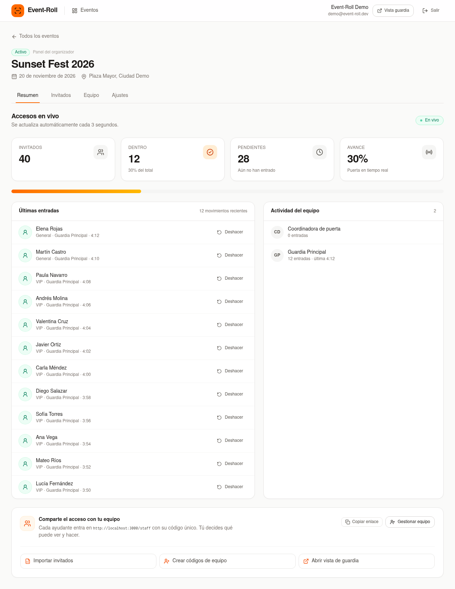
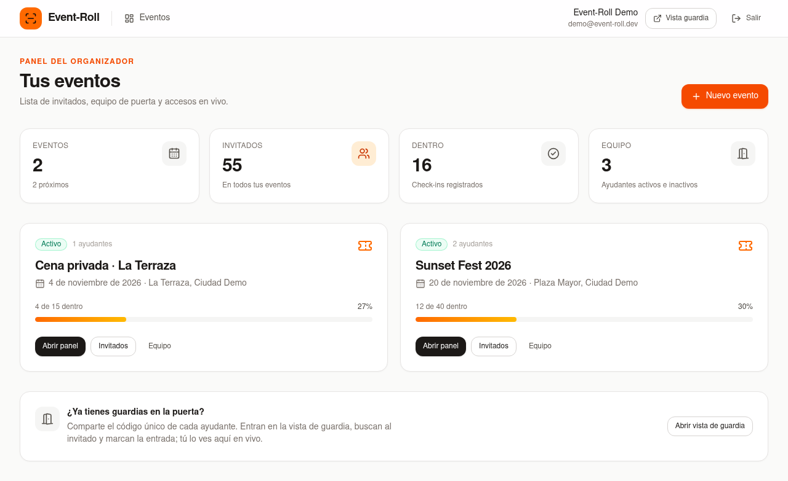
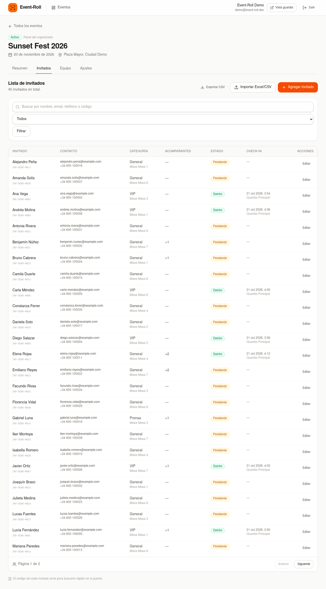
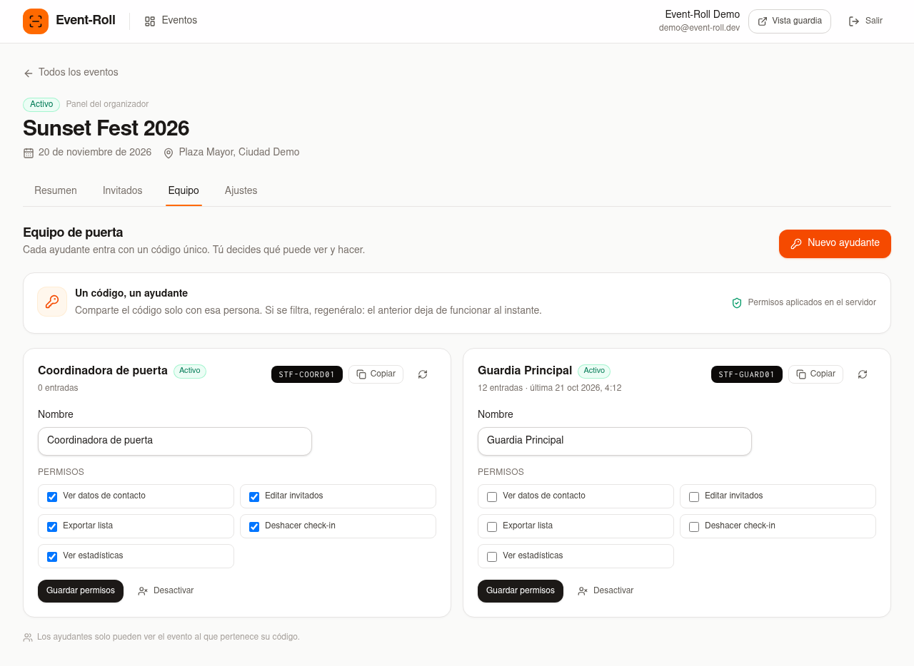
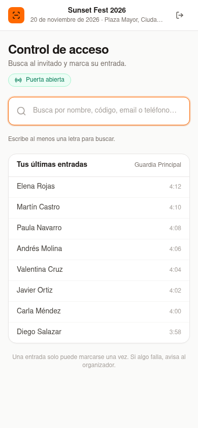

# Event-Roll

**Guest list and live door control for event organizers.** Import the client's Excel, give every helper a unique code, and watch who enters — and who does not — in real time.

[](https://github.com/runer0101/Event-Roll/actions/workflows/ci.yml)


**[Live demo](https://event-roll.vercel.app)** — seeded organizer, no signup.



## The problem

Small event organizers run the door with a spreadsheet, a WhatsApp group and a paper list. Nobody knows which copy is current, guards mark entries on paper, and the person in charge finds out about problems hours later. Every helper can see the whole list, including phone numbers they do not need.

Event-Roll turns that into one live system:

- The organizer imports the guest list and keeps it as the single source of truth.
- Each helper gets a unique access code and only the permissions the organizer grants.
- Guards search a guest and mark the entry; the root organizer sees it live, with the time and the guard who validated it.
- Everything is scoped to the event: a code for event A cannot open event B.

## Features

- **Excel/CSV import with preview** — reads `.xlsx` and `.csv`, maps Spanish/English headers, validates every row, reports problems and skips duplicates.
- **Guest list management** — add, edit, search, filter and delete guests; each one gets a short code for quick lookup.
- **Unique staff codes** — the organizer creates helpers and receives a code such as `STF-7K2M9Q4P`. No email invitations, no passwords for the door.
- **Granular permissions** — contact data, guest editing, CSV export, undo check-in and live stats are toggles per helper, enforced on the server.
- **Live dashboard** — tickets, pending guests, attendance rate, recent entries and staff activity refresh every 3 seconds.
- **Atomic check-in** — a guest can only move `INVITED → CHECKED_IN` once, even if two guards tap at the same time. A rejected second attempt never creates a second entry.
- **Audit trail** — every check-in and undo is recorded with guest, staff member and timestamp.
- **Event lifecycle** — close an event to stop check-ins, reopen it, or delete it with all its data.
- **CSV export** — the organizer (or a helper with permission) downloads the current list; guards without contact permission get a version without emails or phones.
- **Multi-tenant by design** — every query and mutation is scoped by `organizationId`; staff are additionally scoped by `eventId`.

## Roles

| Role | Can do |
| --- | --- |
| **Organizer (root)** | Everything: events, guest list, import, staff, permissions, export, undo check-ins. |
| **Coordinator** | Whatever the root grants: view contact data, edit guests, export, undo check-ins, see live stats. |
| **Guard** | Enter with a code, search guests and mark entries. Contact data and editing are off by default. |

## How it works

1. **Import the list.** Upload the client's Excel or CSV. The browser parses it, shows a preview and flags invalid or duplicated rows before anything is written.
2. **Build the door team.** Create a helper, choose permissions and share the generated code.
3. **Open the door.** The guard enters the code, finds the guest and marks the entry. The organizer's dashboard updates while the queue moves.

## Screenshots

| Organizer dashboard | Live access feed |
| --- | --- |
|  |  |
| **Guest list** | **Staff and permissions** |
|  |  |
| **Guard screen (mobile)** | **Landing** |
|  |  |

## Engineering highlights

- **No double entry, proven at the database level.** Check-in is a conditional `updateMany` (`status = INVITED`) inside a transaction, followed by an audit log. The second scan gets `count = 0` and an "already used" response.
- **Permissions are not just hidden in the UI.** Every server action re-reads the staff row from the database and checks the current permission before touching data. Deactivating a code takes effect immediately.
- **Excel parsing happens before the write.** The browser produces a preview and row-level errors; the server validates the same rows again with Zod before `createMany`. Duplicates are detected by email, then phone + name, then name.
- **Tenant isolation is explicit.** Owner queries use the session's `organizationId`; staff queries use both `organizationId` and `eventId`. A tampered ID returns "not found", not another tenant's data.
- **Live without WebSocket infrastructure.** The dashboard polls a small, session-protected route every 3 seconds. It pauses while the tab is hidden and keeps the initial render server-side.
- **Codes are generated from an unambiguous alphabet** (`ABCDEFGHJKLMNPQRSTUVWXYZ23456789`) to avoid `O/0` and `I/1` mistakes at the door.

## Tech stack

| Layer | Choice |
| --- | --- |
| Framework | Next.js 16 (App Router, Server Actions, Proxy) |
| Language | TypeScript (strict) |
| Database | PostgreSQL + Prisma 7 (`pg` driver adapter) |
| Auth | Auth.js v5 (credentials for organizers, code provider for staff, JWT sessions) |
| UI | React 19 + Tailwind CSS v4 + Lucide |
| Imports | `read-excel-file` + Papa Parse |
| Tests | Vitest + Playwright |
| Tooling | pnpm, ESLint, GitHub Actions |

## Architecture

```
prisma/
├── schema.prisma          User · Organization · Event · Guest · Staff · AccessLog
└── seed.ts                deterministic demo data
src/
├── actions/               auth, events, guests, staff, check-in
├── app/
│   ├── (auth)/            login · register
│   ├── dashboard/         organizer panel (overview, guests, staff, settings)
│   ├── staff/             code login + guard screen
│   └── api/               live feed · CSV export · Auth.js
├── components/            UI, live dashboard, import dialog, staff manager
└── lib/
    ├── import/            browser Excel/CSV parsing
    ├── queries/           tenant-scoped reads
    ├── validations/       Zod schemas
    └── permissions.ts     staff permission model
```

## Getting started

```bash
# 1. PostgreSQL
docker compose up -d

# 2. Install
pnpm install

# 3. Environment
cp .env.example .env
# generate AUTH_SECRET with:
openssl rand -base64 32

# 4. Schema + demo data
pnpm migrate
pnpm seed

# 5. Run
pnpm dev
```

Open <http://localhost:3000>. The deployed demo is at <https://event-roll.vercel.app>.

### Demo credentials

The seed recreates the demo organization on every run.

| Access | Value |
| --- | --- |
| Organizer | `demo@event-roll.dev` / `event-roll-demo` |
| Guard code | `STF-GUARD01` |
| Coordinator code (full permissions) | `STF-COORD01` |
| Dinner guard code | `STF-DINNER1` |

The guard screen is at `/staff`. The organizer panel is at `/dashboard`.

## Scripts

| Script | Purpose |
| --- | --- |
| `pnpm dev` | Development server |
| `pnpm build` / `pnpm start` | Production build / server |
| `pnpm migrate` | Apply Prisma migrations |
| `pnpm seed` | Recreate the deterministic demo data |
| `pnpm typecheck` | TypeScript, no emit |
| `pnpm lint` | ESLint |
| `pnpm test` | Vitest unit tests |
| `pnpm test:e2e` | Playwright end-to-end tests (seeds the DB and boots dev on port 3200) |

## Testing

- **Unit (Vitest, 10 tests)** — dedupe keys, permission defaults and copying, code generation, text normalization.
- **End-to-end (Playwright, 6 tests)** — organizer login, guard login by code, guest check-in seen live by the organizer, contact permission, forbidden export for a guard, CSV import with preview, event creation, and the screenshot suite.
- **CI (GitHub Actions)** — install → Prisma generate → typecheck → lint → unit tests → build, plus a second job with PostgreSQL 18 that applies migrations and runs the e2e suite.

## Deploy for free

1. **Database — Neon Free.** Create a project, copy the **pooled** connection string for the app and the **direct** one for migrations.

   ```bash
   DATABASE_URL="<neon-direct-string>" pnpm exec prisma migrate deploy
   DATABASE_URL="<neon-direct-string>" pnpm seed
   ```

2. **Hosting — Vercel Hobby.** Import the repository and set:

   - `DATABASE_URL` (pooled)
   - `AUTH_SECRET` (`openssl rand -base64 32`)
   - `NEXT_PUBLIC_APP_URL` (your production URL)

   Deploy. The project uses the standard Next.js preset.

3. **Done.** The organizer signs up, imports a list and shares the first staff code.

## Roadmap

- QR scanning at the door (the guest code already exists).
- Entry **and exit** tracking for venues that need occupancy.
- Email/SMS delivery of guest invitations.
- Offline-first guard mode with a sync queue for weak signal.
- Billing for organizations that manage multiple events.

## License

[MIT](LICENSE)
