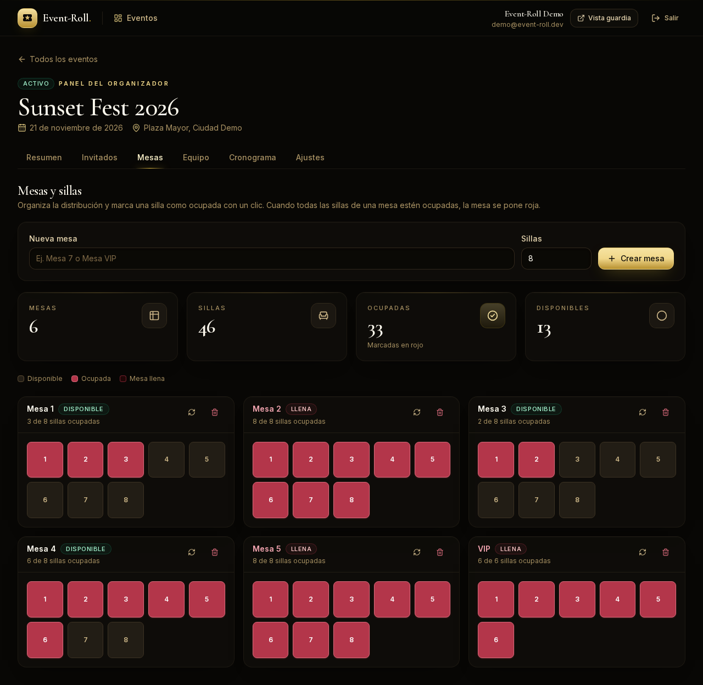
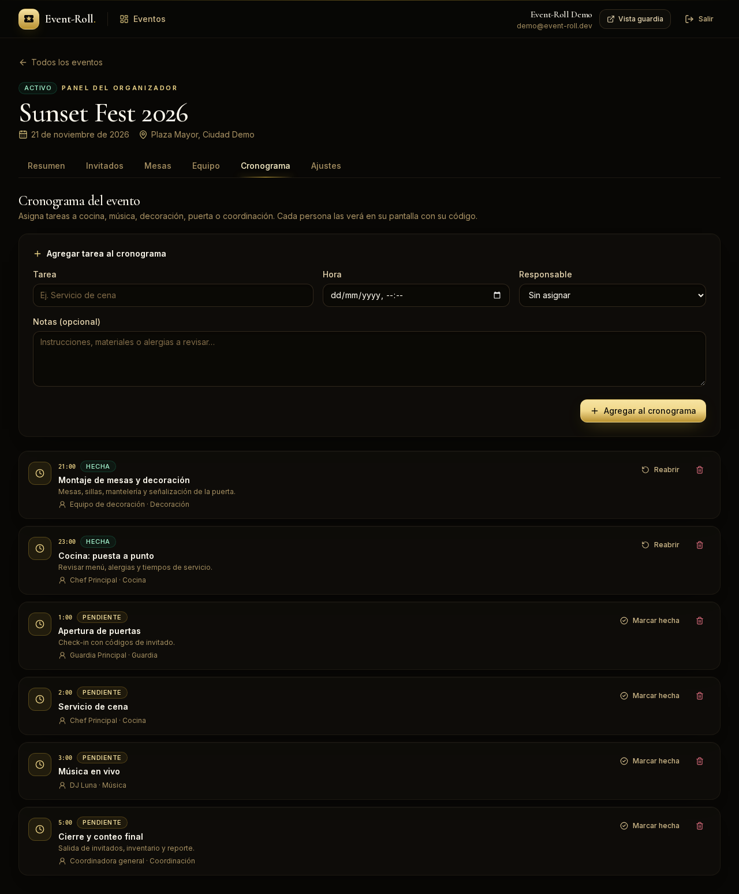
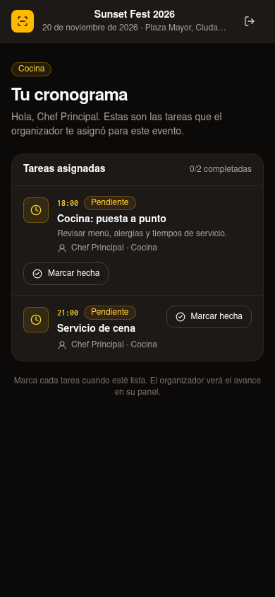

# Event-Roll

**Guest list, seating and live door control for event organizers.** Import the client's Excel, give every team member a unique code, organize tables and the schedule, and watch who enters — and who does not — in real time.

[](https://github.com/runer0101/Event-Roll/actions/workflows/ci.yml)


**[Live demo](https://event-roll.vercel.app)** — seeded organizer, no signup.


## The problem

Small event organizers run the door with a spreadsheet, a WhatsApp group and a paper list. Nobody knows which copy is current, guards mark entries on paper, and the person in charge finds out about problems hours later. Every helper can see the whole list, including phone numbers they do not need.

Event-Roll turns that into one live system:

- The organizer imports the guest list and keeps it as the single source of truth.
- Each helper gets a unique access code and only the permissions the organizer grants.
- Guards search a guest and mark the entry; the root organizer sees it live, with the time and the guard who validated it.
- Everything is scoped to the event: a code for event A cannot open event B.

## Features

- **Excel/CSV import with preview** — reads `.xlsx` and `.csv`, maps Spanish/English headers, validates every row, reports problems and skips duplicates.
- **Guest list management** — add, edit, search, filter and delete guests; each one gets a short code for quick lookup.
- **Tables and chairs** — create tables with a set number of chairs, click a chair to mark it occupied (red), and the whole table turns red when it is full.
- **Team roles** — door, coordination, kitchen, music, decoration or other. Every member gets a unique code and sees only their part of the event.
- **Shared schedule** — tasks with a time, an assignee and a status; the organizer sees the full timeline and each member marks their tasks as done.
- **Granular permissions** — contact data, guest editing, CSV export, undo check-in and live stats are toggles per helper, enforced on the server.
- **Live dashboard** — tickets, pending guests, attendance rate, recent entries and staff activity refresh every 3 seconds.
- **Atomic check-in** — a guest can only move `INVITED → CHECKED_IN` once, even if two guards tap at the same time. A rejected second attempt never creates a second entry.
- **Audit trail** — every check-in and undo is recorded with guest, staff member and timestamp.
- **Event lifecycle** — close an event to stop check-ins, reopen it, or delete it with all its data.
- **CSV export** — the organizer (or a helper with permission) downloads the current list; guards without contact permission get a version without emails or phones.
- **Multi-tenant by design** — every query and mutation is scoped by `organizationId`; staff are additionally scoped by `eventId`.

## Roles

| Role | Can do |
| --- | --- |
| **Organizer (root)** | Everything: events, guest list, import, tables, team, permissions, schedule, export, undo check-ins. |
| **Coordinator** | Whatever the root grants: view contact data, edit guests, export, undo check-ins, see live stats. |
| **Guard** | Enter with a code, search guests and mark entries. Contact data and editing are off by default. |
| **Kitchen / music / decoration** | Enter with a code and see their own schedule, times and event information. No guest check-in by default. |

## How it works

1. **Import the list.** Upload the client's Excel or CSV. The browser parses it, shows a preview and flags invalid or duplicated rows before anything is written.
2. **Build the door team.** Create a helper, choose permissions and share the generated code.
3. **Open the door.** The guard enters the code, finds the guest and marks the entry. The organizer's dashboard updates while the queue moves.
4. **Prepare the room.** Create tables, mark chairs as occupied and assign timed tasks to the kitchen, music and decoration teams.

## Screenshots

| Organizer dashboard | Live access feed |
| --- | --- |
|  |  |
| **Guest list** | **Tables and chairs** |
|  |  |
| **Schedule** | **Staff and roles** |
|  |  |
| **Guard screen (mobile)** | **Kitchen schedule (mobile)** |
|  |  |
| **Landing** | |
|  | |

## Engineering highlights

- **No double entry, proven at the database level.** Check-in is a conditional `updateMany` (`status = INVITED`) inside a transaction, followed by an audit log. The second scan gets `count = 0` and an "already used" response.
- **Permissions are not just hidden in the UI.** Every server action re-reads the staff row from the database and checks the current permission before touching data. Deactivating a code takes effect immediately.
- **Excel parsing happens before the write.** The browser produces a preview and row-level errors; the server validates the same rows again with Zod before `createMany`. Duplicates are detected by email, then phone + name, then name. The import Server Action allows up to 8 MB so a 5 MB spreadsheet does not hit the 1 MB default.
- **Search ignores accents.** Guests store a normalized `searchName`, so "lucia" finds "Lucía" from both the organizer panel and the door screen.
- **Tenant isolation is explicit.** Owner queries use the session's `organizationId`; staff queries use both `organizationId` and `eventId`, and the export route rejects a staff member asking for another event. A tampered ID returns "not found" or 403, not another tenant's data.
- **Audit rows survive guest deletion.** Each access log stores a guest-name snapshot and nulls the foreign key instead of cascading, so the history is not erased when a guest is removed.
- **Revocable staff sessions.** Regenerating a code or deactivating a helper bumps a per-staff session version; tokens issued before that moment stop working immediately.
- **Repeated logins are throttled.** Five failed organizer passwords or eight failed staff codes within ten minutes return a retry message, and a successful login clears the counter. The in-process map is a speed bump; a multi-instance deploy would move it to Redis.
- **Live without WebSocket infrastructure.** The dashboard polls a small, session-protected route every 3 seconds. It pauses while the tab is hidden and keeps the initial render server-side.
- **Seat state is derived, never duplicated.** Every chair is a row; a table is full when all its chairs are occupied. The client updates the UI immediately (red chair, red table) and the server persists each click.
- **The same login serves different roles.** `/staff/event/[id]` reads the member's `canCheckIn`: door and coordination see the check-in console; kitchen, music and decoration see their personal schedule.
- **Codes are generated from an unambiguous alphabet** (`ABCDEFGHJKLMNPQRSTUVWXYZ23456789`) to avoid `O/0` and `I/1` mistakes at the door.

## Tech stack

| Layer | Choice |
| --- | --- |
| Framework | Next.js 16 (App Router, Server Actions, Proxy) |
| Language | TypeScript (strict) |
| Database | PostgreSQL + Prisma 7 (`pg` driver adapter) |
| Auth | Auth.js v5 (credentials for organizers, code provider for staff, JWT sessions) |
| UI | React 19 + Tailwind CSS v4 + Lucide + a 1.9 KB subset of [Symbols Nerd Font](https://www.nerdfonts.com/) |
| Imports | `read-excel-file` + Papa Parse |
| Tests | Vitest + Playwright |
| Tooling | pnpm, ESLint, GitHub Actions |

## Architecture

```
prisma/
├── schema.prisma          User · Organization · Event · Guest · Staff · EventTable · Chair · ScheduleItem
└── seed.ts                deterministic demo data
src/
├── actions/               auth, events, guests, staff, check-in
├── app/
│   ├── (auth)/            login · register
│   ├── dashboard/         organizer panel (overview, guests, tables, staff, schedule, settings)
│   ├── staff/             code login + guard screen
│   └── api/               live feed · CSV export · Auth.js
├── components/            UI, live dashboard, import dialog, seating board, schedule manager
└── lib/
    ├── import/            browser Excel/CSV parsing
    ├── queries/           tenant-scoped reads
    ├── validations/       Zod schemas
    └── permissions.ts     staff permission model
```

## Getting started

```bash
# 1. PostgreSQL
docker compose up -d

# 2. Install
pnpm install

# 3. Environment
cp .env.example .env
# generate AUTH_SECRET with:
openssl rand -base64 32

# 4. Schema + demo data
pnpm migrate
pnpm seed

# 5. Run
pnpm dev
```

Open <http://localhost:3000>. The deployed demo is at <https://event-roll.vercel.app>.

### Demo credentials

The seed recreates the demo organization on every run.

| Access | Value |
| --- | --- |
| Organizer | `demo@event-roll.dev` / `event-roll-demo` |
| Guard code | `STF-GUARD01` |
| Coordinator code (full permissions) | `STF-COORD01` |
| Kitchen code | `STF-COOK01` |
| Music code | `STF-MUSIC1` |
| Decoration code | `STF-DECOR1` |
| Dinner guard code | `STF-DINNER1` |

The guard screen is at `/staff`. The organizer panel is at `/dashboard`.

## Scripts

| Script | Purpose |
| --- | --- |
| `pnpm dev` | Development server |
| `pnpm build` / `pnpm start` | Production build / server |
| `pnpm migrate` | Apply Prisma migrations |
| `pnpm seed` | Recreate the deterministic demo data |
| `pnpm typecheck` | TypeScript, no emit |
| `pnpm lint` | ESLint |
| `pnpm test` | Vitest unit tests |
| `pnpm test:e2e` | Playwright end-to-end tests (seeds the DB and boots dev on port 3200) |

## Testing

- **Unit (Vitest, 29 tests)** — dedupe keys, permission defaults and copying, code generation, text normalization, timezone conversion, CSV escaping, server-side door authorization (including the `canCheckIn` flag and closed events) and login throttling.
- **End-to-end (Playwright, 9 tests)** — organizer login, guard login by code, guest check-in seen live by the organizer, contact permission, forbidden export for a guard, cross-event export rejection, CSV import with preview, event creation, table filling (all chairs red), role-specific schedules, and the screenshot suite.
- **CI (GitHub Actions)** — install → Prisma generate → typecheck → lint → unit tests → build, plus a second job with PostgreSQL 18 that applies migrations and runs the e2e suite.

## Demo scope

This repository is a portfolio demo, not a production deployment. The shortcuts are deliberate:

- The demo organizer credentials are public by design; treat the demo database as disposable and never import real guest data.
- The login throttle lives in process memory and is keyed by identity; a multi-instance deploy would move it to Redis.
- Every event shares `NEXT_PUBLIC_APP_TIMEZONE`; per-event timezones would need a schema change.
- The live dashboard polls every 3 seconds; WebSockets or SSE would be overkill at this scale.
- Email delivery, password reset and billing are out of scope.

See [SECURITY.md](SECURITY.md) for vulnerability reporting.

## Deploy for free

1. **Database — Neon Free.** Create a project, copy the **pooled** connection string for the app and the **direct** one for migrations.

   ```bash
   DATABASE_URL="<neon-direct-string>" pnpm exec prisma migrate deploy
   DATABASE_URL="<neon-direct-string>" pnpm seed
   ```

2. **Hosting — Vercel Hobby.** Import the repository and set:

   - `DATABASE_URL` (pooled)
   - `AUTH_SECRET` (`openssl rand -base64 32`)
   - `NEXT_PUBLIC_APP_URL` (your production URL)

   Deploy. The project uses the standard Next.js preset.

3. **Done.** The organizer signs up, imports a list and shares the first staff code.

This repository's `main` branch is connected to the Vercel project, so pushes to
`main` deploy to production automatically.

## Roadmap

- QR scanning at the door (the guest code already exists).
- Entry **and exit** tracking for venues that need occupancy.
- Email/SMS delivery of guest invitations.
- Offline-first guard mode with a sync queue for weak signal.
- Drag-and-drop floor plan and guest-to-seat assignment.
- Billing for organizations that manage multiple events.

## License

[MIT](LICENSE)
